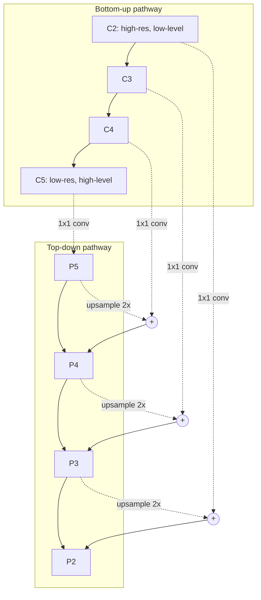
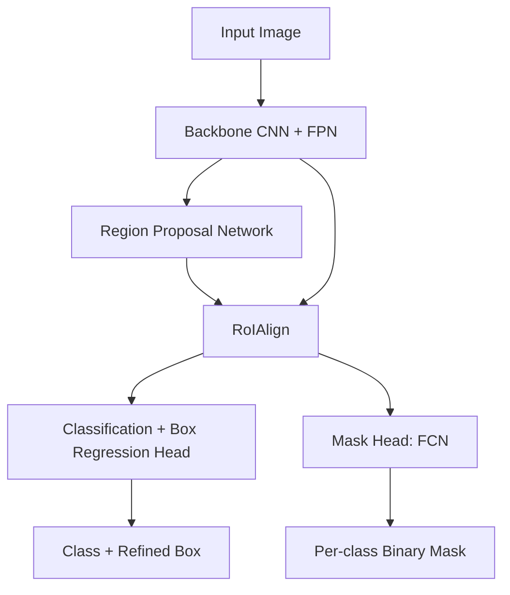
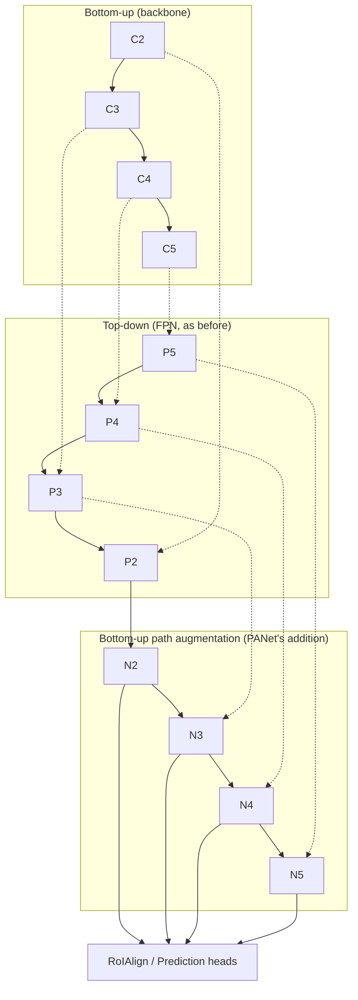
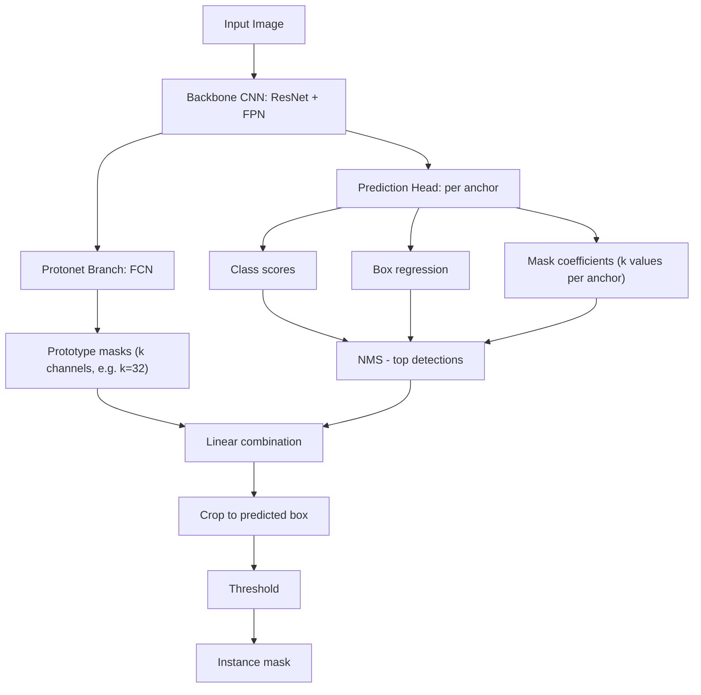

## Q: What is the meaning of TinySegmentation in Image processing or Machine Vision?

A: "Tiny Segmentation" isn't a standard, formally named technique in classic CV literature — it generally refers to **semantic/instance segmentation of small objects**, a known hard sub-problem in image processing and machine vision. Key meaning and challenges:

- **Definition**: Segmenting objects that occupy very few pixels relative to image size (e.g., distant pedestrians, small lesions in medical scans, tiny defects in industrial inspection, small cells/particles in microscopy).
- **Why it's hard**:
  - Downsampling/pooling in CNNs (stride, max-pool) erases fine spatial detail before the decoder can recover it.
  - Severe class imbalance — background dominates pixel counts vs. the tiny foreground region.
  - Low signal-to-noise ratio: a few mislabeled pixels can tank IoU scores disproportionately.
- **Common techniques**:
  - High-resolution feature preservation (skip connections, dilated/atrous convolutions instead of pooling).
  - Multi-scale / feature pyramid networks (FPN) to retain detail at low-level layers.
  - Loss functions robust to imbalance (Dice loss, focal loss, Tversky loss).
  - Patch-based or tiling inference to keep native resolution instead of resizing down.
  - Super-resolution pre-processing to upscale tiny regions before segmentation.

## Q: - Multi-scale / feature pyramid networks (FPN) to retain detail at low-level layers.

explain this in detail.

A: ## Feature Pyramid Networks (FPN) for Tiny Object Segmentation

**The core problem FPN solves:** In a standard CNN backbone (ResNet, VGG, etc.), as you go deeper:
- **Early/shallow layers** → high spatial resolution, but low semantic content (edges, textures, colors).
- **Late/deep layers** → low spatial resolution (due to repeated stride/pooling), but rich semantic content (object-level understanding).

A tiny object might only occupy a handful of pixels. By the time the network reaches its deepest layer (say, after 5 stride-2 downsamples = 32x reduction), a 20x20 pixel object becomes less than 1x1 pixel — it effectively vanishes. Yet that deep layer is where the network has the strongest semantic understanding of "what is an object." This is the fundamental tension FPN resolves.

### Architecture

1. **Bottom-up pathway**: the normal forward pass of the backbone, producing feature maps at decreasing resolutions ($C_2, C_3, C_4, C_5$), each stage halving spatial size while doubling semantic depth.
2. **Top-down pathway**: starting from the deepest map $C_5$, upsample (usually nearest-neighbor x2) at each step to match the resolution of the corresponding bottom-up level.
3. **Lateral connections**: at each level, the upsampled deep features are **element-wise added** to a 1x1-convolved version of the matching bottom-up feature map (the 1x1 conv just matches channel depth, not resolution).
4. Result: a set of merged maps $P_2, P_3, P_4, P_5$ that all carry strong semantic information, but at **multiple resolutions** — including the high-resolution ones where small objects are still spatially visible.

### Why this helps tiny segmentation specifically
- $P_2$ (highest resolution, e.g. 1/4 of input size) retains enough spatial detail that a small object is still several pixels wide, while also being infused with semantic context propagated down from $C_5$.
- The segmentation/detection head can be applied at **every pyramid level**, so small objects are predicted from the high-res, detail-preserving maps, while large objects are predicted from low-res, context-rich maps — each object is matched to the scale best suited for it.
- Without FPN, you'd have to pick one resolution for everything — typically the deepest, most "aware" layer, which is exactly the one that destroys small objects.

### Trade-offs / notes
- Upsampling is coarse (nearest-neighbor), so fine boundary precision for tiny objects still often needs further help (e.g., higher-res input tiling, or dilated convs to avoid downsampling altogether).
- Adds extra compute/memory for maintaining multiple feature map resolutions, but it's relatively cheap compared to running multiple separate networks at different scales (image pyramids).
- Common in detection (RetinaNet, Faster R-CNN+FPN) and segmentation (Mask R-CNN, PANet, many semantic segmentation decoders) — the same idea underlies most modern multi-scale segmentation heads.

## Q: - Loss functions robust to imbalance (Dice loss, focal loss, Tversky loss).
explain this in detail

A: ## Loss Functions Robust to Class Imbalance

In tiny-object segmentation, background pixels vastly outnumber foreground pixels (e.g., 99.9% background vs 0.1% object). Standard **pixel-wise cross-entropy** treats every pixel equally, so a model can achieve deceptively low loss by just predicting "background everywhere" — it barely gets penalized for missing the tiny object entirely. The losses below are designed to counteract this.

### 1. Dice Loss
Based on the **Dice coefficient** (a.k.a. F1 score over sets), which measures overlap between predicted mask $P$ and ground truth $G$:

$$
\text{Dice} = \frac{2|P \cap G|}{|P| + |G|} = \frac{2\sum_i p_i g_i}{\sum_i p_i^2 + \sum_i g_i^2 + \epsilon}
$$

$$
\mathcal{L}_{\text{Dice}} = 1 - \text{Dice}
$$

- $p_i$ = predicted probability for pixel $i$, $g_i$ = ground-truth label (0 or 1), $\epsilon$ is a small constant avoiding division by zero.
- **Why it helps**: it's a *ratio* metric — it directly rewards overlap with the small foreground region, regardless of how large the background is. The huge background class doesn't dominate the score the way it does in pixel-wise cross-entropy, because correctly predicted background (true negatives) don't inflate the Dice score.
- **Weakness**: gradients can be unstable/noisy when the object is extremely small or absent in a training patch (denominator near zero).

### 2. Focal Loss
A modification of cross-entropy that **down-weights easy, well-classified examples** so the loss focuses on hard/rare examples:

$$
\mathcal{L}_{\text{Focal}} = -\alpha_t (1 - p_t)^\gamma \log(p_t)
$$

- $p_t$ = model's predicted probability for the true class.
- $(1-p_t)^\gamma$ is the **modulating factor**: when a pixel is already classified correctly with high confidence ($p_t \to 1$), this term $\to 0$, suppressing its contribution to the loss. Misclassified or uncertain pixels ($p_t$ low) keep a large loss contribution.
- $\gamma$ (typically 2) controls how aggressively easy examples are down-weighted.
- $\alpha_t$ is a static class-weighting term (e.g., upweight the rare foreground class) — combines imbalance-via-weighting with imbalance-via-difficulty.
- **Why it helps for tiny objects**: the overwhelming majority of easy background pixels stop dominating the gradient; training effort concentrates on the hard foreground/boundary pixels where the tiny object lives.
- Originally introduced for object detection (RetinaNet) to handle foreground/background imbalance, then widely adopted in segmentation.

### 3. Tversky Loss
A generalization of Dice loss that lets you **asymmetrically penalize false positives vs. false negatives**:

$$
\text{Tversky} = \frac{\sum_i p_i g_i}{\sum_i p_i g_i + \alpha \sum_i p_i(1-g_i) + \beta \sum_i (1-p_i) g_i}
$$

$$
\mathcal{L}_{\text{Tversky}} = 1 - \text{Tversky}
$$

- $\sum p_i(1-g_i)$ = false positives, $\sum(1-p_i)g_i$ = false negatives.
- When $\alpha = \beta = 0.5$, Tversky loss reduces exactly to Dice loss.
- **Why it helps for tiny objects**: for small structures, false negatives (missing the object entirely) are usually far more costly than false positives (over-segmenting slightly). By setting $\beta > \alpha$ (e.g., $\alpha=0.3, \beta=0.7$), the loss penalizes missed detections more heavily, pushing the model to be more "generous" in predicting the rare foreground class — directly counteracting the tendency to under-predict tiny regions.
- A further extension, **Focal Tversky Loss**, raises the whole term to a power $(1-\text{Tversky})^\gamma$ to additionally focus on hard-to-segment small/rare structures, combining both ideas.

### Practical note
These are frequently **combined** (e.g., `Dice + Focal` or `Dice + weighted BCE`) rather than used alone, since Dice-family losses give good global overlap signal while cross-entropy/focal terms stabilize pixel-level gradients, especially early in training when predictions are essentially random.

## Q: Explain MaskRCNN architecture in detail for image segmentation specially the tiny object.

A: ## Mask R-CNN Architecture (with focus on tiny-object segmentation)

Mask R-CNN extends **Faster R-CNN** (a two-stage object detector) by adding a parallel branch that predicts a pixel-level segmentation mask for each detected object, turning detection into instance segmentation.

### 1. Backbone + FPN
- A CNN (ResNet-50/101, often with **ResNeXt**) extracts feature maps, typically combined with a **Feature Pyramid Network** (see earlier explanation) to produce multi-resolution feature maps $P_2$–$P_5$ (+$P_6$ for RPN).
- **Tiny-object relevance**: without FPN, Mask R-CNN would only use the deepest, most downsampled feature map, which is where small objects vanish. FPN lets small objects be detected/segmented from higher-resolution, less-downsampled levels ($P_2$, $P_3$), while large objects use deeper levels. Each RoI is assigned to a specific pyramid level based on its size (smaller RoIs → higher-res, smaller-stride levels).

### 2. Region Proposal Network (RPN)
- Slides a small network over each FPN level to propose candidate object regions ("anchors") at multiple scales/aspect ratios, outputting objectness scores + box offsets.
- **Tiny-object relevance**: anchor scales must be tuned to include very small sizes (e.g., 8px, 16px) — default anchor configurations (32–512px) tuned for COCO will simply never generate candidate boxes small enough to catch tiny objects. This is one of the most common practical failure points when adapting Mask R-CNN to small-object datasets.

### 3. RoIAlign (the critical fix over RoIPool)
This is the single most important architectural detail for small-object mask quality:
- The original Faster R-CNN used **RoIPool**, which quantizes/rounds the RoI boundaries and bin edges to integer feature-map coordinates — introducing misalignment between the RoI and the extracted features.
- For large objects, this rounding error is a tiny fraction of the object's size and barely matters. For **tiny objects**, the same rounding error can be a large fraction (or all) of the object's extent, completely destroying spatial correspondence between predicted mask pixels and the actual object location.
- **RoIAlign** removes all quantization: it uses **bilinear interpolation** to sample feature values at exact (non-integer) floating-point locations within each bin, preserving precise spatial alignment.
- **Why this matters for tiny objects**: this was the key change (introduced in the Mask R-CNN paper itself) that made pixel-accurate masks possible at all — without it, small-object masks are essentially unusable.

### 4. Classification + Box Regression Head
- Standard fully-connected layers on top of the pooled RoI features, producing class scores and bounding-box refinement — same as Faster R-CNN, decoupled from the mask branch.

### 5. Mask Head (FCN branch)
- A small **Fully Convolutional Network** applied per-RoI (not per-image), typically 4 conv layers + 1 transposed conv (deconv) to upsample, producing a fixed-size (e.g., 28x28) binary mask **per class**.
- Masks are predicted independently per class (`num_classes` output channels), and the classification branch picks which channel to use — this decouples "what class is it" from "what are its pixels," avoiding competition between classes for mask prediction.
- **Tiny-object relevance**: the mask resolution (e.g., 28x28) is fixed regardless of the RoI's actual pixel size. For a tiny object, the RoI crop itself might only be 20x20 pixels in the original image, so the mask head is working with an already up-sampled/interpolated version of very little real information — the mask head's output resolution is **not the bottleneck**, the earlier feature extraction and anchor generation are. Increasing mask-head resolution alone won't recover detail that was never captured upstream.

### Putting it together for tiny objects — what actually needs tuning
1. **FPN levels**: ensure the highest-resolution level ($P_2$, stride 4) is used and not discarded.
2. **Anchor scales in RPN**: add smaller anchor sizes/scales matching your object size distribution.
3. **RoIAlign** (already a given in Mask R-CNN vs RoIPool in Faster R-CNN) — critical, keep it.
4. **Input resolution**: avoid aggressive image resizing/downscaling during preprocessing — tiny objects can disappear below the stride resolution before the network even sees them.
5. **NMS/RPN proposal count**: may need more proposals or lower NMS thresholds since the density of tiny objects per image can be high (e.g., crowd scenes, cell counting).
6. **Training sampler**: the RoI sampling for mask/box heads (foreground/background ratio, e.g. 1:3) may need rebalancing since tiny foreground RoIs are rare and easily outcompeted by larger ones.

## Q: Explain PANet here
Common in detection (RetinaNet, Faster R-CNN+FPN) and segmentation (Mask R-CNN, PANet, many semantic segmentation decoders) — the same idea underlies most modern multi-scale segmentation heads.

A: ## PANet (Path Aggregation Network)

PANet builds directly on top of FPN/Mask R-CNN, adding extra pathways to fix a specific weakness: in plain FPN, information from the **lowest-level, highest-resolution** features ($C_2$) has to travel through the *entire* top-down pathway (potentially 100+ layers in a deep ResNet) before it ever reaches the final feature map used for prediction. PANet shortens this path.

### 1. Bottom-up path augmentation (the key addition)
- After the standard FPN top-down pathway produces $P_2, P_3, P_4, P_5$, PANet adds a **second bottom-up pathway**: starting from $P_2$ (highest resolution), it progressively downsamples and fuses (via lateral connections, similar to FPN's) up to produce $N_2, N_3, N_4, N_5$.
- This creates a much **shorter path** (just a few conv/downsample layers) for precise, high-resolution localization information from $C_2/P_2$ to reach the deepest feature levels — instead of having to travel the full depth of the backbone (through dozens of layers in $C_2 \to C_3 \to C_4 \to C_5$).
- **Why this matters for tiny objects**: tiny objects depend heavily on fine low-level cues (edges, precise boundaries) that originate in $C_2$. In plain FPN, these cues have already been diluted/mixed by the time they reach deeper semantic levels. The shortcut path in PANet preserves and propagates that low-level precision with much less degradation, improving localization accuracy especially for small instances.

### 2. Adaptive Feature Pooling
- Normally (as in Mask R-CNN), each RoI is assigned to exactly **one** FPN level based on its size (small RoI → high-res level, large RoI → low-res level).
- PANet instead pools RoI features from **all levels** ($N_2$–$N_5$) and fuses them (element-wise max or sum), rather than committing to a single heuristically-chosen level.
- **Why this matters for tiny objects**: the single-level assignment heuristic is a rough rule of thumb and can mis-assign borderline-sized objects to a level that's not actually optimal for them. Adaptive pooling lets the network draw on information from multiple scales simultaneously, so tiny objects aren't entirely dependent on one "guessed" level being correct.

### 3. Fully-connected fusion for mask prediction
- PANet's mask branch keeps the usual FCN (convolutional) path but adds a parallel **fully-connected branch**, then fuses both predictions.
- FC layers capture more global, per-instance context (since they look at the whole RoI at once rather than local receptive fields), which complements the FCN branch's local, translation-equivariant precision.
- **Why this matters for tiny objects**: for very small RoIs, local convolutional receptive fields may not have much signal to work with; an FC branch pulls in whole-RoI context to disambiguate what's foreground vs. background within that small crop.

### Net effect
PANet's changes are all about **shortening information paths and avoiding hard scale-assignment decisions** — both are disproportionately important for tiny objects, since they have the least margin for error: a single bad level assignment or a few diluted layers of signal can be the difference between "detected" and "invisible."

## Q: Can you explain the YOLACT architecture in short - layer by layer

A: ## YOLACT Architecture (layer by layer, brief)

YOLACT ("You Only Look At CoefficienTs") is a **real-time, single-stage** instance segmentation network. Instead of RoI-pooling + per-instance mask heads (like Mask R-CNN), it splits mask generation into two parallel, cheaper sub-tasks that get combined at the end.

1. **Backbone (ResNet-101) + FPN**: standard feature extraction, producing multi-scale feature maps, same role as in Mask R-CNN/RetinaNet.

2. **Protonet branch (one shared FCN over the whole image)**: taken off one FPN level (the highest-resolution one used), a small fully-convolutional network outputs $k$ (e.g., 32) **prototype masks** — full-image-resolution feature maps capturing generic spatial patterns (not yet tied to any specific instance). This runs **once per image**, not per-detection.

3. **Prediction head (per anchor, like RetinaNet/SSD)**: a single-stage, anchor-based head run over each FPN level, producing for every anchor:
   - class scores,
   - box regression offsets,
   - $k$ **mask coefficients** — essentially weights saying "how much of each prototype mask contributes to this specific instance's mask."

4. **NMS**: standard non-max suppression on the class+box outputs to pick final detections, same as any single-stage detector.

5. **Mask assembly (linear combination)**: for each surviving detection, its mask is computed as a **linear combination** of the $k$ prototypes using that detection's predicted coefficients, followed by a sigmoid:
$$
M = \sigma(P \cdot C^T)
$$
where $P$ is the prototypes matrix (pixels × $k$) and $C$ is the coefficient vector for that instance.

6. **Crop + threshold**: the assembled mask is cropped to the predicted bounding box and thresholded to produce the final binary instance mask.

### Why this matters for tiny objects
- Because **prototypes are computed once at full/near-full image resolution** (not pooled per-RoI like Mask R-CNN), fine spatial detail is preserved network-wide rather than destroyed by a fixed small RoI crop/resize — this can help tiny objects retain boundary precision.
- However, YOLACT has no RoIAlign-style instance-specific feature extraction — mask quality for a tiny object depends entirely on the prototypes and a handful of per-instance coefficients having captured that specific small region well, which can be less reliable than Mask R-CNN's dedicated per-instance mask head for very small, dense, or overlapping tiny objects.
- Its main advantage is **speed** (one-shot, no per-RoI branch), at some cost to fine-grained mask accuracy compared to two-stage methods — a trade-off worth noting when tiny-object precision is the priority over real-time throughput.

## Q: Now can we come to the traditional technique of Computer vision for tiny instance segmentation - Classic CV technique.
at the end list of top notch low-level cv technique used for this

A: ## Classical (Pre-Deep-Learning) CV Techniques for Tiny Instance Segmentation

Before CNN-based approaches, tiny-object segmentation relied on low-level image processing + classical pattern recognition. These techniques are still relevant today as **pre-processing, post-processing, or lightweight/embedded alternatives** to deep learning.

### 1. Thresholding-based segmentation
- **Global thresholding (Otsu's method)**: automatically finds a threshold that best separates foreground from background by minimizing intra-class variance. Works when tiny objects have consistent intensity/contrast against background (e.g., bright cells on a dark microscope slide).
- **Adaptive/local thresholding**: computes a different threshold per local neighborhood, useful when illumination is uneven across the image — critical for small objects since a single global threshold often fails when lighting varies across the frame.
- **Weakness**: breaks down with low contrast, noise, or when tiny objects share intensity with background clutter.

### 2. Morphological operations
- **Erosion/Dilation, Opening/Closing**: used to clean up thresholded binary masks — opening removes small noise specks, closing fills small holes inside detected blobs.
- **Top-hat / black-hat transform**: specifically designed to highlight small bright (or dark) structures smaller than a given structuring element size, by subtracting an opened/closed version of the image from the original — directly useful for enhancing tiny objects before thresholding.
- **Watershed transform**: treats the image (or its gradient/distance transform) as a topographic surface and "floods" from local minima to separate touching/overlapping small blobs — classic technique for instance-level separation of small clustered objects (e.g., touching cells).

### 3. Edge & gradient-based methods
- **Canny edge detector**: multi-stage (Gaussian smoothing → gradient → non-max suppression → hysteresis thresholding) edge detector; boundaries of tiny objects can be captured if contrast is sufficient, though noise sensitivity increases at small scales.
- **Laplacian of Gaussian (LoG) / Difference of Gaussians (DoG)**: blob-detection operators tuned to a specific scale (sigma) — by choosing a small sigma, these specifically respond to small blob-like structures, forming the basis of classical **blob detectors** (e.g., used in SimpleBlobDetector in OpenCV).

### 4. Region-based / clustering methods
- **Connected component analysis**: after binarization, labels contiguous foreground regions; combined with size/shape filtering (area, aspect ratio, circularity) to isolate or discard tiny blobs of interest.
- **Region growing**: starts from seed points (often manually placed or detected via local maxima) and grows outward based on similarity criteria (intensity, color, texture) — good for well-separated small structures with a reliable seed point.
- **Superpixel methods (SLIC, Felzenszwalb)**: over-segment the image into small, perceptually meaningful regions; tiny objects can align well with a handful of superpixels, useful as a pre-processing step before classification.

### 5. Contour-based analysis
- **`findContours` + shape descriptors** (area, perimeter, circularity, Hu moments): after binarization, contours are extracted and filtered/classified by geometric properties — a classic, interpretable way to isolate small round/blob-like objects (e.g., counting small particles).

### 6. Template matching / correlation
- Sliding a known small template (e.g., a cell shape, a defect pattern) across the image and scoring via normalized cross-correlation — effective when the tiny object's appearance is fairly consistent and known in advance.

### Why these matter even in the deep-learning era
- Used as **pre-processing** (contrast enhancement, candidate region proposals) to help a downstream CNN focus on relevant areas.
- Used as **post-processing** (morphological cleanup, watershed splitting of merged DL-predicted masks, connected-component filtering of spurious tiny false positives).
- Preferred in **low-power/embedded or real-time industrial inspection** settings where a full deep network isn't feasible.

---

### Top low-level CV techniques for tiny-object segmentation (quick reference list)
1. **Otsu's / adaptive thresholding** — intensity-based foreground/background separation.
2. **Top-hat / black-hat morphological transform** — enhances small bright/dark structures before thresholding.
3. **Watershed transform** — separates touching/overlapping tiny instances.
4. **Laplacian of Gaussian (LoG) / Difference of Gaussians (DoG) blob detectors** — scale-tuned detection of small blobs.
5. **Canny edge detection** — boundary extraction for contour-based isolation.
6. **Connected component analysis + shape filtering** — isolates/classifies small regions by size, area, circularity.
7. **Region growing from seed points** — grows precise masks around a detected tiny-object seed.
8. **Superpixel segmentation (SLIC, Felzenszwalb)** — perceptual over-segmentation aligned to small structures.
9. **Normalized cross-correlation template matching** — detects known small patterns directly.
10. **Distance transform** — often paired with watershed to find object centers/seeds for splitting clustered tiny blobs.

## Q: Can you help me 5 questions deep level which can be asked for a experience researcher in image processing including machine learning architecture in semantic segmentation - question could be wider; i.t. ask the question is such a way I can understand the depth level problem happens in real time production these models.

A: ## 5 Deep-Level Research Questions — Semantic Segmentation in Production

These are framed the way a panel might probe a senior researcher — not "define X" questions, but ones that expose whether someone has *actually* shipped and maintained segmentation models at scale, where theory meets failure modes.

---

### 1. Distribution shift between training data and live deployment
*"Your semantic segmentation model achieves 92% mIoU on your held-out test set, but field engineers report visibly wrong masks for a subset of real-world footage six months post-deployment. Walk me through how you'd diagnose whether this is a domain-shift problem, a label-noise problem, or a genuine model-capacity problem — and what instrumentation would you have needed in production *before* this happened to catch it earlier rather than relying on manual complaints?"*
- Probes: understanding of covariate shift vs. concept drift, the difference between offline metric degradation and silent failure, whether they'd proactively log prediction entropy/confidence distributions, embed drift-detection (e.g., comparing live feature statistics to training distribution), and whether validation sets actually represent deployment conditions (sensor type, lighting, compression artifacts, seasonal variation).

### 2. The accuracy–latency–memory trade-off under real hardware constraints
*"You need to deploy a segmentation model on an edge device with a strict 30ms per-frame budget and 2GB memory, but your best research-grade model (e.g., a Transformer-based decoder) needs 150ms on a full GPU. Describe the full space of trade-offs you'd explore — not just 'use a smaller backbone' — including where accuracy loss concentrates (which classes/regions degrade first under quantization/pruning), and how you'd defend a chosen operating point to a product owner who only sees a single 'accuracy number' drop."*
- Probes: real understanding of quantization-aware training vs. post-training quantization, structured pruning vs. distillation trade-offs, whether they know that **small/thin structures (like tiny segmented objects or fine boundaries) degrade disproportionately** under aggressive compression compared to large uniform regions, and whether they can translate an engineering constraint into a principled model-selection argument rather than guesswork.

### 3. Boundary and small-object failure under annotation and metric limitations
*"mIoU looks stable across your last three model iterations, yet downstream customers keep reporting that thin structures (wires, small tools, distant pedestrians) are frequently missed or have jagged, unstable boundaries frame-to-frame. Explain why a metric like mIoU can fail to reflect this problem at all, what metric or evaluation protocol you'd introduce instead, and how you'd determine whether the root cause is the loss function, the annotation quality (boundary labeling inconsistency between annotators), or the architecture's effective receptive field/resolution."*
- Probes: whether they understand that mIoU is dominated by large-region overlap and is insensitive to small/thin object errors, familiarity with boundary-specific metrics (boundary F1/BF-score, Hausdorff distance), inter-annotator agreement analysis, and architecture-level reasoning about stride/downsampling destroying thin structures before the loss function ever sees them.

### 4. Temporal instability in video-based segmentation pipelines
*"When you run your per-frame segmentation model over video, individual frames look reasonable, but the mask boundaries flicker/jitter between consecutive frames even though nothing in the scene moved. Diagnose the likely causes across the full pipeline — from training data (is it frame-independent, with no temporal consistency objective?), to model architecture (is there any recurrence/memory?), to post-processing (is there any temporal smoothing?) — and propose where in that pipeline you would intervene first, and why that choice minimizes risk versus retraining from scratch."*
- Probes: understanding that per-frame models have no incentive to be temporally consistent unless explicitly trained/constrained for it, awareness of techniques like optical-flow warping for temporal loss, lightweight temporal smoothing/Kalman-style post-processing vs. architectural fixes (ConvLSTM, memory-augmented decoders), and crucially, an engineering instinct for which fix is cheapest/safest to ship first.

### 5. Silent miscalibration and downstream decision risk
*"Your segmentation model's softmax confidence for a safety-critical class (e.g., 'drivable road' or 'surgical tool') is consistently high (>0.9) even on inputs where the mask is visibly wrong. Explain why a well-trained classifier/segmenter can be simultaneously accurate on average and badly miscalibrated on the tail, how you would detect this systematically across a large unlabeled production stream (not just a curated test set), and what you would change — architecturally, in the loss function, or in post-hoc calibration — knowing that any fix must not regress the overall mIoU that stakeholders are tracking."*
- Probes: understanding of calibration vs. accuracy as orthogonal properties, methods like temperature scaling, Monte Carlo dropout/deep ensembles for uncertainty estimation, awareness that focal/Dice losses (common in segmentation) can *worsen* calibration even while improving overlap metrics, and the organizational skill of balancing a safety fix against a KPI stakeholders already trust.

---

Each of these is designed to force the candidate to reason **across the full lifecycle** — data, loss, architecture, metric, deployment constraint, and organizational trade-off — rather than reciting a technique in isolation, which is where real production-depth experience shows up versus purely academic familiarity.

## Q: Can we can same like question in traditional cv approach based segmentation?

A: ## 5 Deep-Level Research Questions — Classical/Traditional CV-Based Segmentation in Production

Same intent as before, but targeted at engineers/researchers who rely on classical pipelines (thresholding, morphology, watershed, edge/blob detectors) rather than deep learning — probing where these techniques silently break down at scale.

---

### 1. Robustness to uncontrolled illumination and sensor variation
*"Your Otsu-thresholding-based segmentation pipeline works flawlessly on your validation set captured under lab lighting, but in the field, cameras experience changing ambient light, shadows, and sensor auto-exposure adjustments. Walk me through exactly why a single global threshold fails here, what specific illumination model you'd assume (additive vs. multiplicative gain, local vs. global), and how you'd redesign the preprocessing chain (e.g., illumination normalization, adaptive thresholding, CLAHE) to be provably robust — and what quantitative test you'd run to prove the fix actually generalizes rather than just working on the few field images you happened to look at."*
- Probes: real understanding of why global statistics (single threshold) fail under non-stationary imaging conditions, whether they can reason about the illumination model mathematically (not just "try adaptive threshold and see"), and whether they have a rigorous validation protocol beyond eyeballing a handful of corrected images.

### 2. Parameter sensitivity and the "it worked in the demo" trap
*"Your watershed-based cell/particle separation pipeline has five tunable parameters (Gaussian blur sigma, distance-transform threshold, minimum marker distance, morphological kernel size, minimum region area). It performs well on your curated demo dataset. Explain how you would systematically characterize the sensitivity of your output quality to each parameter — not just grid-search for the best combination — and how you would detect, in production, when incoming images drift outside the parameter regime that was validated, before a customer notices garbage output."*
- Probes: whether the candidate understands that classical pipelines often have brittle, hand-tuned parameter chains with no learned adaptivity, knowledge of sensitivity analysis techniques, and whether they'd build drift/outlier detection on *image statistics* (noise level, contrast histogram, blur estimate) to flag when the tuned parameters are no longer valid — something deep-learning engineers often skip but classical-CV engineers cannot afford to.

### 3. Touching/overlapping object separation failure modes
*"Your watershed pipeline correctly separates well-isolated particles but consistently merges or over-segments clusters of 3+ touching tiny objects in dense regions of the frame. Diagnose precisely where in the pipeline this failure originates — is it the distance-transform's inability to resolve markers at that density, insufficient marker seeding, or a fundamentally wrong assumption about object shape (e.g., assuming roughly convex blobs when real objects are irregular)? Then explain what you would change, and critically, how a fix for 'better separation' might simultaneously *increase* false splits on legitimately single large objects — how would you balance that trade-off quantitatively rather than by visual inspection?"*
- Probes: deep understanding of watershed's actual failure geometry (local minima collisions, over-segmentation vs. under-segmentation trade-off), whether they can reason about a fix's side effects on a different failure mode (a classic blind spot), and whether they have any quantitative metric (e.g., over/under-segmentation rate per region density) rather than anecdotal judgment.

### 4. Generalization across object scale, texture and class variation
*"Your pipeline (thresholding + morphological cleanup + contour-based shape filtering) was tuned for roughly circular particles of a known size range. A new product line introduces irregularly shaped, partially transparent, or texture-rich small objects. Explain, from first principles, which of your pipeline's implicit assumptions (intensity homogeneity, convexity, consistent size range, consistent contrast polarity) will break first, and how you'd redesign the pipeline to be assumption-light enough to handle the new case — versus the alternative of maintaining two completely separate tuned pipelines. What's the real engineering cost of each path?"*
- Probes: awareness that classical pipelines encode strong implicit priors that deep learning doesn't need, ability to enumerate those priors explicitly (most engineers who just "tune parameters" can't articulate them), and mature judgment about technical-debt trade-offs (maintaining multiple brittle pipelines vs. investing in more general techniques).

### 5. Real-time throughput vs. accuracy trade-offs on constrained hardware
*"Your classical pipeline (Gaussian blur, Canny edge detection, contour extraction, shape filtering) meets accuracy targets but is too slow for your required 60fps throughput on an embedded ARM processor with no GPU. Walk through where the actual computational bottleneck is likely to be (convolution-heavy steps vs. per-contour iterative steps), what algorithmic-level optimizations exist (separable kernels, integral images, fixed-point arithmetic, downsampling before edge detection and upsampling results) versus what you'd lose in small-object sensitivity by downsampling, and how you'd prove the optimized pipeline still meets accuracy requirements specifically on your hardest (smallest/lowest-contrast) cases, not just on average."*
- Probes: concrete understanding of where compute actually goes in a classical pipeline (not deep learning FLOPs intuition), whether they recognize that **downsampling for speed is exactly the operation most damaging to tiny-object detection**, and whether their validation protocol specifically stress-tests the worst-case small-object scenarios rather than average-case accuracy.

---

The throughline across all five: classical CV pipelines don't "learn" robustness — every assumption (illumination, scale, shape, density, contrast) is implicit and hand-coded, so production failures trace directly back to a violated assumption, and a strong researcher should be able to name the assumption, not just patch the symptom.

## Q: Can we can same like question in modern CNN/Transformer approach based segmentation?

A: ## 5 Deep-Level Research Questions — Modern CNN/Transformer-Based Segmentation in Production

Same format, now targeting architectures like DeepLabV3+, U-Net variants, SegFormer, Mask2Former, SAM-style promptable segmentation, and ViT-based dense prediction — probing failure modes specific to attention mechanisms, patch-based tokenization, and large pretrained backbones.

---

### 1. Quadratic attention cost vs. dense prediction resolution
*"You want to use a Transformer-based segmentation model (e.g., SegFormer/Mask2Former-style) for high-resolution input (e.g., 4K industrial inspection images), but full self-attention over that many tokens is computationally infeasible. Walk through the actual architectural strategies used to make Transformers viable for dense, high-resolution prediction (patch merging/hierarchical stages, windowed/local attention, linear-attention approximations, or hybrid CNN-Transformer designs), and explain specifically which of these approaches risks losing fine detail needed for small/thin objects, versus which preserves it — and how you'd empirically validate that trade-off rather than trusting the paper's reported benchmark numbers."*
- Probes: real understanding of why vanilla ViT doesn't scale to dense prediction without hierarchical/windowed tricks (Swin-style), whether the candidate can reason about which efficiency trick specifically harms small-object/fine-boundary accuracy (e.g., window attention loses long-range context; patch merging loses local resolution), and whether they validate on the metric that matters (small-object IoU) rather than overall mIoU.

#### Short Answer

**The core problem**: Full self-attention is $O(n^2)$ in token count. A 4K image at even a modest patch size yields hundreds of thousands of tokens — quadratic attention over that is computationally infeasible.

**Strategies used to make Transformers viable for dense, high-res prediction:**

1. **Hierarchical/patch-merging stages (Swin, PVT, SegFormer's MiT backbone)**: start with small patches at high resolution, progressively merge neighboring tokens into coarser ones at deeper stages (like CNN downsampling). Attention cost drops because token count shrinks each stage.
   - *Risk to small objects*: progressive merging is literally spatial downsampling — a tiny object can be averaged away by the time deep stages are reached, same failure mode as CNN stride/pooling.

2. **Windowed/local attention (Swin's shifted windows)**: restrict self-attention to small local windows (e.g., 7x7 patches) instead of the whole image, with shifting between layers to let information cross window boundaries over depth.
   - *Risk to small objects*: local windows limit long-range context — fine if the tiny object's defining features are local, but hurts if correct classification needs broader scene context (e.g., disambiguating a small object via its surroundings).

3. **Linear/efficient attention approximations (Performer, Linformer-style)**: approximate full attention with linear-complexity kernels or low-rank projections.
   - *Risk to small objects*: approximation error is roughly uniform across tokens, but since small objects are already represented by very few tokens, even small approximation noise has outsized relative impact on their signal.

4. **Hybrid CNN-Transformer designs (e.g., DeepLab-style CNN stem + Transformer stages, or Mask2Former's pixel decoder)**: use a CNN backbone/FPN for high-resolution low-level features, Transformer only on coarser/global stages, then fuse via a decoder with skip connections.
   - *Best preserves small-object detail*, since the CNN stem/FPN explicitly retains a high-resolution feature path (same reasoning as FPN for tiny-object segmentation), while the Transformer handles global reasoning on the coarser scale.

**Validation**: don't trust paper-reported mIoU — specifically measure **small-object IoU / boundary F1 on a size-stratified test set** (bucket ground-truth objects by pixel area), and compare pre/post efficiency-trick accuracy *only on the smallest bucket*. Overall mIoU is dominated by large objects and will hide exactly the degradation that matters here.

#### Detailed Answer — Transformer Scaling for High-Resolution Dense Prediction

##### Why the problem exists
Standard self-attention computes, for $n$ tokens, pairwise attention weights:
$$
\text{Attn}(Q,K,V) = \text{softmax}\left(\frac{QK^T}{\sqrt{d_k}}\right)V
$$
The $QK^T$ term is $O(n^2 d)$ in compute and $O(n^2)$ in memory. For a ViT-style model with 16x16 patches on a 4K image ($3840\times2160$), you get roughly $240 \times 135 \approx 32{,}000$ tokens — attention would require a $32{,}000 \times 32{,}000$ matrix per head, per layer. This is why dense, high-resolution Transformer segmentation needs structural changes, not just "a bigger GPU."

##### 1. Hierarchical architectures with patch merging (Swin, PVT, SegFormer's MiT backbone)
Instead of a single resolution throughout (as in plain ViT), these architectures mimic a CNN's multi-stage structure:
- Stage 1 operates on small patches (high token count, high resolution, small receptive field).
- At each subsequent stage, neighboring tokens (e.g., 2x2 groups) are **merged/concatenated and linearly projected** into fewer, higher-dimensional tokens — halving spatial resolution each stage, same as a CNN's stride-2 downsampling.
- Attention cost per stage drops because $n$ shrinks quadratically with each merge.
- SegFormer specifically uses this MiT (Mix Transformer) backbone, then a very lightweight all-MLP decoder that fuses multi-stage features — explicitly FPN-like in spirit.

**Mechanism of small-object information loss**: Each merge step is a lossy, learned pooling operation. A small object represented by, say, 4 tokens at stage 1 might be represented by a single blended token by stage 3. Once that compression happens, the specific sub-token-level boundary information is **irrecoverable** by later layers, no matter how expressive the attention is afterward — this is structurally identical to CNN stride/pooling information loss, just reframed in token space.

##### 2. Windowed / local attention (Swin's shifted windows)
Swin restricts self-attention computation to non-overlapping local windows (e.g., 7x7 tokens), making attention cost linear in image size rather than quadratic:
$$
O(n^2) \rightarrow O(n \cdot M^2)
$$
where $M$ is the fixed window size. To let information propagate across window boundaries (since a naive windowed scheme would make windows fully independent, losing global context), Swin **shifts** the window partitioning by half a window size in alternating layers, so tokens near a window edge in one layer end up in the interior of a window in the next layer — progressively building cross-window context over depth.

**Mechanism of small-object impact**: Objects fully contained within one window get normal local self-attention — fine detail is preserved *locally*. But:
- If correct recognition of a tiny/ambiguous object requires attending to context *far* outside its window (e.g., scale cues from a reference object elsewhere in the frame), that signal only propagates gradually, layer by layer, via the shift mechanism — effectively acting like a limited, slow "receptive field growth," conceptually similar to a CNN's receptive field growing with depth, with similar risk of insufficient context for small/ambiguous instances in shallow-to-mid layers.
- Positive side: unlike patch-merging, windowed attention by itself doesn't destroy spatial resolution — it only restricts *who talks to whom*, so fine boundary detail within a window is not inherently lost.

##### 3. Linear / efficient attention approximations (Performer's FAVOR+, Linformer's low-rank projection, Nyströmformer, etc.)
These replace the exact softmax attention with an approximation that avoids materializing the full $n \times n$ matrix:
- **Linformer**: projects $K$ and $V$ to a fixed lower-dimensional sequence length $k \ll n$ via learned linear projections, making complexity $O(nk)$.
- **Performer**: approximates the softmax kernel using random feature maps so attention can be computed as $O(n)$ via a different factorization order ($Q(K^TV)$ instead of $(QK^T)V$).

**Mechanism of small-object impact**: These are *mathematical approximations* of true attention, introducing bounded but non-zero error into the attention weights. For large/well-represented objects (many tokens, redundant signal), this noise averages out. For small objects (very few tokens carrying their entire signal), the same absolute approximation error represents a much larger *relative* corruption of their already-scarce representation — i.e., approximation error is roughly token-count-independent, but signal-to-noise ratio for tiny objects is inherently lower, so they're disproportionately vulnerable.

##### 4. Hybrid CNN-Transformer designs (CNN stem + Transformer stages, Mask2Former's pixel decoder)
- Use a convolutional stem or backbone (ResNet/FPN-like) to produce a **high-resolution, low-level feature map early**, retaining fine spatial detail the way classic FPN does.
- Apply Transformer blocks only at coarser stages (lower token count by construction, since the CNN has already downsampled) for global reasoning/long-range context.
- Mask2Former's **pixel decoder** explicitly reintroduces a multi-scale, FPN-style upsampling path, and its **masked attention** mechanism restricts cross-attention in the Transformer decoder to only the predicted mask region of each query, improving focus and convergence for small/precise object masks specifically.

**Mechanism of small-object preservation**: because the high-resolution feature path exists *outside* the quadratic-attention bottleneck entirely (handled by cheap convolutions), fine detail is never forced through an information-destroying compression step just to make attention tractable — the Transformer only operates where its global-context strength is actually needed (coarse, semantic reasoning), not where it would be a liability (fine boundary localization).

##### How to validate empirically (not just trust the paper)
1. **Size-stratified evaluation**: bucket ground-truth instances by pixel area (e.g., <32², 32²–96², >96², following COCO's small/medium/large convention) and report mIoU/AP **per bucket**, not just overall — overall mIoU is dominated by large objects and will mask small-object degradation entirely.
2. **Boundary-specific metrics**: boundary F1-score (BF-score) or Hausdorff distance specifically on small-object masks, since IoU alone is already an imprecise signal at small pixel counts (a 1-pixel boundary shift on a 10x10 object is a much larger relative IoU hit than the same shift on a 200x200 object).
3. **Controlled ablation**: swap only the attention mechanism (full vs. windowed vs. linear) while holding backbone depth, parameter count, and training schedule fixed — isolate the effect of the efficiency trick itself rather than confounding it with other architecture changes.
4. **Synthetic stress test**: insert small synthetic objects of known size/shape into held-out background images at controlled scales, and measure detection/segmentation accuracy as a function of object size directly — removes dataset-specific confounds and gives a clean size-vs-accuracy curve.

### 2. Tokenization artifacts and patch-boundary errors
*"Your Transformer-based segmentation model processes the image via fixed-size patch tokens (e.g., 16x16), and you notice segmentation masks consistently show grid-aligned artifacts or boundary discontinuities at patch edges for small objects that happen to straddle two patches. Explain the architectural root cause of this phenomenon, why it's fundamentally different from a CNN's sliding-window-induced errors, and what specific mitigations (overlapping patches, shifted-window designs, decoder upsampling strategy, or auxiliary dense supervision) you would evaluate — and how you would prove a fix actually removes the artifact rather than just making it visually subtler."*
- Probes: deep architectural knowledge of patch tokenization's discretization bias, awareness that this is a distinct failure mode from CNN receptive-field/stride issues, familiarity with Swin Transformer's shifted-window mechanism as a specific answer to this exact problem, and rigor in validating fixes with a boundary-specific metric rather than visual inspection.

#### Detailed Answer — Tokenization Artifacts and Patch-Boundary Errors

##### Architectural root cause
A patch-based Transformer tokenizer (e.g., ViT's `Conv2d(stride=16, kernel=16)` patch embedding) partitions the image into a **fixed, non-overlapping grid**. Each patch is linearly projected into a single token *independently* — there is no cross-patch mixing at all until the first self-attention layer. This means:
- Every pixel's information is first compressed into whichever single patch it happens to fall into, with **zero knowledge of neighboring patches** at the point of tokenization.
- If a small object straddles a patch boundary, its pixels get split into two (or four) completely separate token representations, each only seeing its own fragment of the object with no shared context at the input level.
- Any inconsistency in how attention/downstream layers interpret these two fragments (e.g., slightly different confidence, slightly different implied boundary location) manifests as a visible seam exactly on the patch grid line — because that grid line is a literal, fixed discontinuity baked into the input representation, not an emergent effect of any learned computation.

##### Why this differs fundamentally from CNN sliding-window errors
A CNN's convolution is **translation-equivariant and overlapping by construction**: a 3x3 kernel slides with stride 1 (or small stride), so each output position's receptive field overlaps heavily with its neighbors — there is no fixed "grid seam" where feature computation is artificially discontinuous. CNN errors at small-object boundaries typically come from **resolution loss** (too much downsampling, so detail blurs out), which produces *smooth, gradual* degradation. In contrast, patch tokenization errors are a **hard partition artifact**: the boundary is sharp, grid-aligned, and reproducible at the exact same pixel coordinates regardless of image content, since it stems directly from a fixed, non-overlapping input segmentation — a structurally different failure mode (discretization bias) rather than a smoothing/information-loss one.

##### Mitigations to evaluate
1. **Overlapping patch embedding** (used in some ViT variants, e.g., overlapping patch merging in PVTv2/SegFormer): use a convolution with stride smaller than kernel size (e.g., kernel=7, stride=4) instead of non-overlapping stride=kernel patchify. This gives each token partial visibility into neighboring regions from the very first layer, directly reducing the hard-seam effect at the source.

2. **Shifted-window designs (Swin-style)**: even though primarily introduced for attention efficiency, the alternating window shift also means that a patch pairing that was split in one layer may be co-located within the same window in the next layer — progressively blending information across the original grid lines over depth, reducing (but not eliminating at the input level) the artifact's propagation to the output.

3. **Decoder upsampling strategy**: how the final per-token predictions are upsampled back to pixel space matters a lot. A naive nearest-neighbor or bilinear upsample of coarse per-patch logits will reproduce blocky, grid-aligned artifacts directly. Using a **learned, convolutional decoder** (e.g., Mask2Former's pixel decoder, or SegFormer's lightweight MLP decoder operating on multi-stage fused features) lets the network learn smooth, content-aware upsampling that can actively correct for grid misalignment rather than mechanically reproducing it.

4. **Auxiliary dense supervision**: adding an auxiliary loss at intermediate resolution (deep supervision) or a boundary-aware loss term (e.g., penalizing predictions specifically near object boundaries regardless of patch grid position) forces the network to allocate representational capacity toward resolving exactly this kind of boundary-level inconsistency, rather than letting it go unpenalized if overall mIoU still looks fine.

##### How to prove a fix actually removes the artifact (vs. just hiding it)
- **Grid-alignment correlation test**: measure whether segmentation error (boundary disagreement with ground truth) is **statistically correlated with the patch grid's fixed coordinates** across many images — i.e., bin pixel-level errors by their offset modulo the patch size. If errors spike specifically at multiples of the patch stride, the artifact is still structurally present even if it "looks" subtler; a genuine fix should flatten this correlation to near-zero.
- **Targeted synthetic test**: place a small synthetic object at many different sub-pixel/sub-patch offsets relative to the grid (same object, shifted by 1 pixel at a time across a full patch width) and measure whether segmentation quality varies periodically with that offset. A model without the artifact should show roughly flat performance across offsets; a model that still has it will show a periodic dip exactly at patch boundaries.
- Avoid relying on visual inspection alone — grid artifacts can become less visually obvious (smoothed by a better decoder) while still being measurably present in the error statistics above, which is the "visually subtler but not actually fixed" trap the question is pointing at.

### 3. Catastrophic forgetting and domain adaptation when fine-tuning large pretrained backbones
*"You fine-tune a large pretrained Transformer backbone (e.g., trained on ImageNet-22k or a foundation segmentation model like SAM) on your narrow domain dataset (small target objects, limited size). After fine-tuning, performance on your target domain improves, but the model unexpectedly degrades on edge cases that resemble its original pretraining distribution, and/or shows reduced robustness to input perturbations it previously handled well. Explain the mechanism behind this degradation, how you would decide between full fine-tuning, parameter-efficient tuning (LoRA/adapters/prompt-tuning), or frozen-backbone + trainable decoder-only approaches, and what evaluation protocol would catch this regression before deployment rather than only measuring in-domain accuracy gains."*
- Probes: understanding of catastrophic forgetting and representation drift when fine-tuning large pretrained models, practical familiarity with parameter-efficient fine-tuning trade-offs (not just "LoRA is cheaper" but *why* it preserves prior representations), and whether their evaluation protocol includes out-of-domain/robustness regression testing, not just target-metric improvement.

#### Detailed Answer — Catastrophic Forgetting & Domain Adaptation When Fine-Tuning Large Pretrained Backbones

##### Mechanism behind the degradation
A large pretrained backbone (ImageNet-22k classifier, or a segmentation foundation model like SAM) encodes a broad, general-purpose feature representation learned from a huge, diverse distribution. Fine-tuning on a narrow domain dataset (e.g., small target objects, limited sample size) updates **all** the backbone's weights via gradient descent toward minimizing loss on that narrow distribution only.

- Because the fine-tuning dataset is narrow and small, the gradient signal pushes weights toward features that are locally useful for *that* distribution, with **no gradient pressure at all to preserve generalization** to inputs unlike the fine-tuning set — the original pretraining data isn't in the loss anymore, so nothing stops drift away from it.
- This is **catastrophic forgetting**: the network doesn't "remember" broad representational structure just because it was learned first; each gradient step nudges shared weights toward the new objective, and after enough steps the representation specializes, overwriting general features that happened not to be reinforced by the new data.
- With a **small fine-tuning dataset**, this effect is amplified: few samples means the model can effectively memorize/overfit narrow patterns rather than learning a representation that *extends* the pretrained one — so edge cases resembling the original broad distribution (which the fine-tuning set doesn't cover) lose the robustness the pretrained model used to have.
- Reduced robustness to perturbations (noise, lighting, blur) specifically shows this: pretraining on a large diverse set typically bakes in some implicit robustness via sheer data diversity; narrow fine-tuning data lacks that diversity, so the model's effective robustness regresses toward what the *narrow* set alone would produce, not what the original model achieved.

##### Full fine-tuning vs. parameter-efficient tuning vs. frozen-backbone
**Full fine-tuning**:
- Updates every parameter — highest capacity to adapt, but also the highest risk of forgetting, since nothing constrains how far weights move from their pretrained values.
- Appropriate only when the fine-tuning dataset is large/diverse enough to itself provide good coverage, which is rarely true in a "narrow domain, limited size" scenario as described here.

**Parameter-efficient tuning (LoRA, adapters, prompt-tuning)**:
- Freezes the original pretrained weights and learns a small number of additional parameters (e.g., LoRA's low-rank update matrices $\Delta W = BA$ inserted into attention/MLP projections) that are added to (not replacing) the frozen weights.
- **Why this preserves prior representations**: because the original weights never change, the backbone's original behavior remains fully recoverable (e.g., by zeroing the adapter), and the learned update is constrained to a low-rank/small-capacity subspace — this acts as an implicit regularizer, limiting how far the effective function can drift from the pretrained one, directly reducing catastrophic forgetting risk compared to full fine-tuning.
- This is usually the right default for "narrow domain, limited data" scenarios precisely because it can't overwrite the broad representation, only add a small correction on top.

**Frozen-backbone + trainable decoder-only**:
- The most conservative option: backbone features are used as-is (zero forgetting risk on the backbone itself), only the task-specific head/decoder is trained.
- Appropriate when the frozen features are already expressive enough for the new task (common with strong foundation models like SAM/DINO), and is the safest choice when preserving original backbone robustness is a hard requirement — at the cost of some achievable in-domain accuracy compared to allowing some backbone adaptation.

**Decision heuristic**: the smaller/narrower the fine-tuning data and the more the deployment still needs to handle the pretrained model's original broad distribution (edge cases, perturbation robustness), the further you should move toward frozen-backbone/parameter-efficient tuning rather than full fine-tuning — full fine-tuning is only safe when your target distribution has enough scale/diversity to substitute for, not just augment, the original pretraining distribution.

##### Evaluation protocol to catch this before deployment
The key failure mode is that **this regression is invisible if you only measure improvement on your target/in-domain validation set** — you need evaluation explicitly designed to detect drift from the original distribution:

1. **Held-out original-distribution regression set**: keep a frozen, untouched subset of the original pretraining-like distribution (or a standard public benchmark reflecting it) as a permanent regression test, and require that fine-tuning not degrade performance on it beyond a defined tolerance — treat this as a hard gate, not just a metric to watch.
2. **Perturbation/robustness test suite**: run standardized corruption benchmarks (noise, blur, brightness/contrast shifts, compression artifacts — akin to ImageNet-C style corruptions) before and after fine-tuning, and compare robustness curves, not just clean accuracy — this directly measures the "reduced robustness to perturbations" symptom described in the question.
3. **Representation-level drift metric**: measure feature-space distance (e.g., CKA — Centered Kernel Alignment, or simple cosine similarity of backbone embeddings) between the pretrained and fine-tuned backbone on a shared probe set, to quantify *how much* the representation moved, independent of any downstream task metric — catches silent representational drift even before it shows up as an accuracy regression on any particular eval set.
4. **Size-stratified / scenario-stratified evaluation**: since the question specifically centers on small target objects and edge cases, ensure the regression test explicitly includes the size/scenario diversity the original model handled (not just a generic benchmark average) — otherwise the regression set itself might not be sensitive enough to catch the specific failure.

### 4. Foundation-model promptable segmentation reliability at small scale
*"You use a promptable segmentation foundation model (SAM-style) with point or box prompts to segment small objects in a production pipeline. You observe the model performs well for medium/large objects from a single prompt, but for tiny objects, a single point prompt frequently produces an incorrect mask (wrong scale/wrong region) requiring multiple prompt attempts. Explain architecturally why ambiguity resolution in these models (mask disambiguation via multiple mask outputs + confidence scores) breaks down specifically at small scale, and describe a concrete strategy — prompt engineering, multi-point prompting, automatic prompt refinement, or hybrid detector-then-prompt pipelines — you would build to make this reliable at production scale without manual intervention per image."*
- Probes: knowledge of how promptable segmentation models resolve prompt ambiguity (multi-mask output + IoU-prediction head) and why this mechanism is less reliable when the object's scale is near the model's effective resolution floor, and whether the candidate thinks in terms of a full pipeline (e.g., using a small-object detector to generate reliable box prompts automatically) rather than relying on single manual prompts.

#### Detailed Answer — Foundation-Model Promptable Segmentation Reliability at Small Scale

##### Architectural root cause of the ambiguity-resolution breakdown
SAM-style models resolve prompt ambiguity via a specific mechanism: given a single point prompt, the mask decoder outputs **multiple candidate masks** (typically 3, corresponding to "whole object," "part," and "subpart" interpretations), each paired with a predicted **IoU/confidence score**, and the pipeline picks the highest-scoring one.

This mechanism depends on the model's internal image embedding having enough **spatial resolution and distinguishable feature density around the prompt location** to separate these interpretations meaningfully:

- SAM's image encoder (a ViT) downsamples the image substantially (typically to a feature map at 1/16th resolution, e.g., 64x64 for a 1024x1024 input). A tiny object (say, 10x10 pixels in the original image) is reduced to a **sub-pixel-scale footprint** in that embedding — often less than 1 full "cell" in the feature grid.
- With so few (or fractional) feature cells actually representing the object, the three candidate masks the decoder generates become **poorly differentiated** — there isn't enough distinct spatial information at that location to produce genuinely different "whole/part/subpart" hypotheses, so the decoder effectively guesses, and the predicted confidence scores become less reliable indicators of actual mask quality (the confidence head itself is trained on the same coarse embedding and inherits its blind spot).
- A single point prompt is also **less spatially informative in absolute terms for a small object**: one point on a large object strongly constrains "this region, roughly this scale," because nearby image content and feature context reinforce the right object extent. For a tiny object, that same single point, given the coarse embedding, is nearly indistinguishable from a point placed on background/clutter right next to it — the model has very little margin to correctly infer object *scale* when the whole object barely registers in its internal feature resolution.
- In short: the ambiguity-resolution mechanism assumes the embedding has enough information density around the prompt to separate plausible mask hypotheses — an assumption that specifically breaks down once the target object shrinks below the model's effective feature-grid resolution.

##### Concrete strategy for production-scale reliability (no manual per-image intervention)

**1. Hybrid detector-then-prompt pipeline (primary recommendation)**
- Run a lightweight small-object detector (e.g., a tuned anchor-based or FPN-based detector, as discussed earlier — small anchors, high-res feature levels) first to generate **tight bounding boxes** around candidate tiny objects.
- Feed SAM a **box prompt** (not a point) derived from that detection, since a box directly constrains scale and extent — removing the exact ambiguity (what scale is intended) that a single point prompt leaves unresolved for small objects.
- This fully automates the pipeline (no manual prompt placement) and shifts the scale-disambiguation burden to a model (the detector) that's specifically built and tuned for small-object localization, rather than relying on SAM's generic ambiguity-resolution mechanism to get it right by chance.

**2. Multi-point prompting as a secondary/fallback refinement**
- If only point-based prompting is available (e.g., no detector, or interactive refinement needed), issue **multiple positive points** sampled within the candidate region (e.g., detector's predicted centroid plus a few nearby points) rather than a single point — this gives the decoder more consistent spatial evidence about intended scale, improving the stability of the top-scoring mask.
- Can be combined with one or two **negative points** just outside the expected small-object boundary to explicitly suppress the "whole scene/large region" misinterpretation, which is a common failure mode when a single positive point is ambiguous at small scale.

**3. Automatic prompt refinement via iterative mask-conditioned re-prompting**
- Use SAM's own output mask + IoU score from a first pass as a signal: if predicted IoU confidence is below a calibrated threshold (indicating likely ambiguity), automatically generate a refined prompt — e.g., take the centroid of the initial (possibly wrong-scale) mask, crop a tighter region around it, and re-run the point/box prompt at that refined location/scale — effectively a cheap, automatic "zoom and retry" loop without any human in it.

**4. Input-resolution tiling for the encoder itself**
- Since the root cause is the image encoder's fixed downsampling ratio relative to object size, running SAM on **cropped, upsampled tiles** around candidate regions (rather than the full image at once) directly increases the small object's effective footprint in the embedding — same principle as patch-based/tiled inference used in classical tiny-object segmentation, directly addressing the resolution mismatch rather than working around it at the prompt level.

##### Why the hybrid detector-then-prompt approach is the strongest default
It directly fixes the root cause — insufficient embedding resolution relative to object scale — by **supplying the missing scale information externally** (via a tight box from a purpose-built small-object detector) rather than hoping the foundation model's generic, embedding-resolution-limited ambiguity-resolution mechanism infers it correctly from a single point. It's also the most production-friendly: fully automatic, no manual tuning per image, and reuses standard detector infrastructure already common in small-object pipelines.

### 5. Training-serving skew from preprocessing/resolution mismatches
*"Your CNN/Transformer segmentation model was trained with images resized/padded to a fixed square resolution (e.g., 512x512) using a specific interpolation method and normalization statistics. In production, the serving pipeline (written by a different team, possibly in a different language/runtime) implements the resize/pad/normalize logic slightly differently (different interpolation algorithm, different padding color, slightly different mean/std precision). Explain why this kind of training-serving skew is especially damaging to a model's sensitivity to *small* objects specifically (versus large objects), how you would detect this class of bug systematically (not by chance observation), and what engineering practice you'd mandate across teams to prevent it from recurring."*
- Probes: whether the candidate understands that small objects are the most sensitive indicator of any sub-pixel/interpolation-level preprocessing mismatch (large objects mask the error, tiny objects don't), practical experience with training-serving skew as a real, common, and underrated production bug class, and organizational maturity (e.g., shared preprocessing libraries, golden-output regression tests across training and serving code paths) rather than just a model-level fix.

#### Detailed Answer — Training-Serving Skew from Preprocessing Mismatches

##### Why this is specifically damaging to small objects (vs. large objects)

**1. Interpolation algorithm differences**
Resizing involves resampling pixel values at new coordinates — nearest-neighbor, bilinear, bicubic, and Lanczos all produce **different pixel values at sub-pixel positions**, especially around edges and fine detail.
- For a **large object**, it occupies many pixels both before and after resize; small per-pixel interpolation differences average out over a large area — the object's overall shape/position/classification signal barely changes.
- For a **small object** (say, 15x15 pixels), the *entire object* might be represented by only a handful of resampled pixels. A different interpolation method can shift edge locations by a pixel or two, blur/sharpen boundary pixels differently, or even change whether a thin structure survives the resize at all — this is a large *relative* change to the object's entire representation, not an averaged-out local effect.

**2. Padding color mismatch**
If training pads with, say, black (0,0,0) but serving pads with a different value (grey, reflected border, or mean-color padding), any object located near the image border or whose receptive field extends into the padded region sees **different context pixels** than what the model learned to expect.
- Large, centrally-located objects are rarely affected (far from padding).
- Small objects are more likely to be fully contained within a receptive field that includes padding if they're near edges, and even when not near the border, **any tiny object's effective receptive field is a much larger proportion of its own size** — so contamination from differently-valued neighboring context (including padding-adjacent regions) proportionally corrupts more of the little information the model has about that object.

**3. Normalization precision differences**
Slightly different mean/std values or floating-point precision shift every pixel's normalized value by a small constant offset/scale.
- This is a **global, uniform shift** — in principle it affects all objects equally in absolute terms.
- But because small objects already have very little redundant signal (few pixels, low effective SNR as established in earlier answers), the *same absolute* normalization shift is a larger *relative* perturbation to their representation — consistent with the general pattern: tiny objects have the least margin to absorb any systematic numerical discrepancy, of any kind, between training and serving.

**Unifying principle**: large objects have redundant, spatially abundant signal that acts as a buffer absorbing small systematic preprocessing discrepancies; tiny objects have no such buffer — every pixel effectively "matters," so any training-serving mismatch, however small in absolute terms, consumes a much larger fraction of their total information content. This is why small-object accuracy is the most sensitive diagnostic signal for this entire bug class, even when it's invisible in aggregate/overall metrics.

##### How to detect this systematically (not by chance observation)

1. **Golden-output regression testing across the training/serving boundary**: take a fixed set of raw input images, run them through *both* the training-time preprocessing code and the actual serving pipeline code (same runtime/language as production), and assert **pixel-level numerical equivalence** (or bounded tolerance) between the two preprocessed tensors — not just "looks similar," but exact diff on tensor values. This should be an automated CI test, run on every change to either pipeline, not a manual one-off check.
2. **End-to-end model-output parity test**: feed the same raw images through the full pipeline (preprocessing + model) in both the training/offline environment and the production serving environment, and compare final outputs (logits/masks) directly — catches any discrepancy regardless of which specific preprocessing step introduced it.
3. **Size-stratified canary metric in production**: continuously monitor live model output quality (e.g., via periodic human-reviewed samples or proxy confidence/calibration metrics) **stratified by object size**, specifically watching the smallest-object bucket as the most sensitive canary — a drop concentrated there, while overall metrics look stable, is a strong signal of exactly this class of bug.
4. **Preprocessing fingerprinting**: log a hash or checksum of the exact preprocessing configuration (interpolation method, padding value, normalization constants, library version) alongside both the training run and the serving deployment, and automatically flag any mismatch between the two — turns an implicit assumption into an explicit, auditable artifact.

##### Engineering practice to mandate across teams

- **Single shared preprocessing library/module**, versioned and used identically by both the training pipeline and the serving pipeline — ideally the *exact same code* (e.g., a shared package, or the preprocessing logic exported/traced as part of the model artifact itself, such as baking resize/normalize into the exported ONNX/TorchScript graph) rather than two independently maintained reimplementations in different languages.
- If a cross-language reimplementation is unavoidable (e.g., training in Python, serving in C++/Java for latency), **mandate the golden-output regression test described above as a release-blocking CI gate** for any change to either side — never allow a serving-side preprocessing change to ship without automated verification against the training-side reference outputs.
- Treat preprocessing configuration (interpolation method, padding value/mode, normalization constants, precision) as part of the **model's versioned contract/metadata**, not an implementation detail left to each team's discretion — any pipeline consuming the model should be required to read these parameters from that shared contract rather than hardcoding them independently.

---

The throughline here: modern CNN/Transformer segmentation models trade classical CV's *explicit* assumptions for *implicit*, learned ones baked into tokenization, pretraining distribution, and prompt mechanisms — so production failures require reasoning about architecture-internal mechanics (attention windows, patch boundaries, foundation-model priors) rather than simple parameter assumptions, and small objects are almost always the canary that exposes these issues first.
